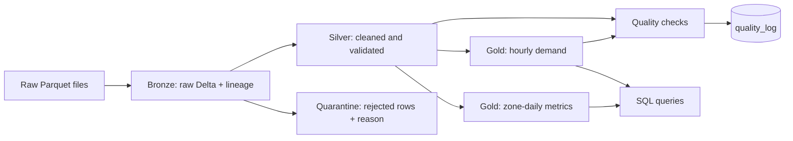

# Lakehouse Data Pipeline (PySpark + Delta Lake)

An end-to-end **medallion-architecture** data pipeline built with PySpark and Delta Lake on NYC Yellow Taxi trip data. It ingests raw files, validates and cleans them, builds analytics-ready tables, and runs automated data-quality checks. It runs locally and on Databricks.

## Architecture



| Layer | Table | What happens |
|---|---|---|
| Bronze | `bronze_trips` | Raw files landed in Delta with `source_file` and `ingested_at` lineage columns. No rows dropped. |
| Silver | `silver_trips` | Renamed columns, validation rules, de-duplication, derived fields (duration, speed, tip %). Partitioned by month. |
| Silver | `silver_rejected_trips` | Rows that failed a rule, kept with a `reject_reason` so data loss is auditable. |
| Gold | `gold_hourly_demand` | Trips, average distance/duration, revenue and tip % per day and hour. |
| Gold | `gold_zone_daily` | Trips, revenue and average fare per pickup zone and day. |
| Ops | `quality_log` | Every check result from every run, appended over time. |

## Design decisions

- **Quarantine instead of silent drops.** Invalid rows go to a separate Delta table with a reason, so the cleaning logic can be audited and tuned.
- **Pure transformation functions.** `silver.clean()` takes a DataFrame and returns `(valid, rejected)`, which makes it unit-testable without touching storage.
- **Quality gate.** The pipeline fails loudly if any check fails, including a reconciliation check that gold trip totals match silver row counts.
- **Runs anywhere.** `spark_session.py` detects Databricks and otherwise builds a local Delta-enabled session.

## Dataset

NYC TLC Yellow Taxi trip records (Parquet), published by the NYC Taxi & Limousine Commission. Download one or more monthly files from the official TLC trip-record data page and place them in `data/raw/`. Raw data is git-ignored.

## Setup

Requirements: Python 3.10+, Java 11 or 17.

```bash
python -m venv .venv
source .venv/bin/activate        # Windows: .venv\Scripts\activate
pip install -r requirements.txt
```

The first run downloads the Delta Lake jars, so it needs an internet connection.

## Run

```bash
python -m src.run_pipeline                    # full pipeline
python -m src.run_pipeline --steps silver gold quality   # selected steps
python -m src.run_sql                         # run the analytics queries
python -m pytest                              # unit tests
```

## Running on Databricks

1. Upload the raw Parquet files to a Unity Catalog volume.
2. Set `PIPELINE_BASE_PATH` to the volume path (or edit `src/config.py`).
3. Run `src/run_pipeline.py` from a Databricks Repo or job. Delta and the Spark session come from the runtime.
4. In `sql/queries.sql`, replace the `delta.` path references with table names if you register the tables.

## Project structure

```
src/
  config.py          paths and validation thresholds
  spark_session.py   local / Databricks session factory
  bronze.py          raw ingestion
  silver.py          cleaning, validation, quarantine
  gold.py            aggregate tables
  quality_checks.py  automated checks + quality_log
  run_pipeline.py    pipeline entry point
  run_sql.py         runs sql/queries.sql
sql/queries.sql      analytics queries on the gold layer
tests/test_silver.py unit tests for the cleaning logic
```

## Results

_To be added after running on real data: row counts per layer, rejection breakdown, runtime, and sample query output._

## Roadmap

- [ ] Add a baseline model (for example trip-duration or demand prediction) tracked with MLflow
- [ ] Incremental loads with Delta `MERGE` instead of full overwrite
- [ ] Orchestrate with Databricks Workflows
- [ ] Dashboard on the gold tables
